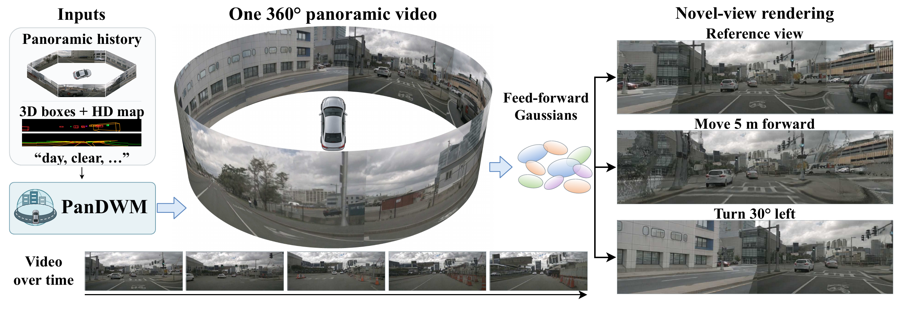
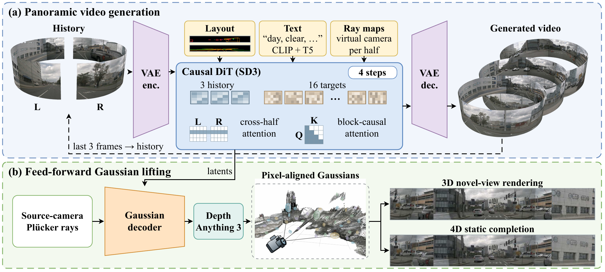

# PanDWM: Panoramic 4D Driving World Models

Code implementation for the paper:

> **PanDWM: Panoramic 4D Driving World Models**
>
> Jiajun Sun<sup>1</sup>\*, [Zeyu Zhang](https://steve-zeyu-zhang.github.io/)<sup>2</sup>\*†, Zeyu Ren<sup>3</sup>, Guangfeng Jiang<sup>2</sup>, Yang Zhao<sup>4</sup>, and [Hao Tang](https://ha0tang.github.io/)<sup>2</sup>‡
>
> <sup>1</sup>Shenzhen University, <sup>2</sup>Peking University, <sup>3</sup>The University of Melbourne, <sup>4</sup>La Trobe University
>
> \*Equal contribution. †Project lead. ‡Corresponding author.
>
> ### Paper (coming soon) | Website (coming soon) | [Model](https://huggingface.co/AIGeeksGroup/PanDWM)

---

## Citation

```
@article{sun2026pandwm,
  title={PanDWM: Panoramic 4D Driving World Models},
  author={Sun, Jiajun and Zhang, Zeyu and Ren, Zeyu and Jiang, Guangfeng and Zhao, Yang and Tang, Hao},
  year={2026}
}
```

---

## 🏃 Introduction



Driving world models typically represent the surround scene as six pinhole-camera videos, whose separate optical centres force the model to learn cross-view consistency. PanDWM instead generates a single 360° panoramic band, split into two overlapping halves so that every camera boundary lies inside one image, and conditions it on 3D boxes and HD maps stitched into the band.



The framework has two parts:

- **Panoramic video generation:** the band is generated causally, one window at a time. Each window has 3 history frames and 16 target frames. A four-step student is distilled from a block-causal video diffusion model (the 50-step causal teacher) and trained on its own generated history.
- **Gaussian lifting:** a feed-forward decoder lifts each frame into 3D Gaussians along the calibrated camera rays. 4D Gaussians add static Gaussians from neighbouring frames to fill unseen regions. A render refiner can denoise rendered views at lateral shifts.

On the nuScenes validation set, the student matches the FID of its 50-step causal teacher (10.1 vs. 9.93) and lowers FVD-1 from 47.7 to 37.4, at 1.96 s instead of 33.7 s per frame.

## 📁 Repository Layout

This release is the code that produced the paper results, as it ran on our SLURM clusters. Cluster paths were replaced by placeholders (see [Paths](#paths)); nothing else was changed. Each folder under `pandwm_code/` is one code tree that the job scripts put on `PYTHONPATH`.

| Folder | Contents |
|---|---|
| `pandwm_code/PanDWM_long_horizon_20260928` | Model (`dwm_pano/models/crossview_temporal_dit_pano.py`), base pipelines, OpenDWM `dwm` package, data loading, teacher rollouts |
| `pandwm_code/PanDWM-cfdmd-A-20261008` | Student distillation (`src/dwm_pano_cfdmd/pipeline_v8_4.py` and its parents), training configs, job scripts for training and generation |
| `pandwm_code/PanDWM_eval149_20261011` | Evaluation protocol: clip manifests, generation runners, FID/FVD, flicker, controllability and long-video analysis |
| `pandwm_code/PanDWM-gs-aa-ft` | 3D Gaussian decoder (`dwm_pano/models/gs_decoder_pano.py`, `pipelines/ctsd_pano_gs_decoder.py`) and its early training stages |
| `pandwm_code/PanDWM-gs4d-20261002` | 4D Gaussian decoder training (`dwm_pano_4d`) and its configs |
| `pandwm_code/PanDWM-ft3-20261030` | Final decoder fine-tuning (G3b), Depth Anything 3 relabelling, generated-scene evaluation |
| `pandwm_code/PanDWM-cov3-20261101` | Reconstruction evaluation: scene builder (`gs_scene_v3.py`), targets, masks, renderer and scorer (`dwm_pano/recon/`) |
| `pandwm_code/PanDWM_d2_refiner_20261021` | Render refiner (model, data, training, `d2_refine.py`) |
| `pandwm_code/PanDWM-fuse-20261031` | Multi-view consistency check (`consistency_eval.py` only) |
| `scripts/gaussian/` | Job scripts for the reconstruction table, the generated-scene table and the refiner |
| `docs/` | [Data preparation](docs/data.md) and [table-by-table reproduction](docs/reproduce.md) |

Many other scripts in these trees are development diagnostics; the entry points for every result are listed in [docs/reproduce.md](docs/reproduce.md).

## 📦 Data Preparation

PanDWM uses the [nuScenes](https://www.nuscenes.org/) dataset (train 700 scenes, validation 150 scenes). Panoramas, condition images and 12 Hz index files are prepared as follows; details and checksums are in [docs/data.md](docs/data.md).

1. **Panoramas and conditions.** The panoramic bands (`rgb/`) and the stitched 3D-box and HD-map conditions (`bbox/`, `hdmap/`) come from the preprocessed releases [`zeyuren2002/nuscene-360_train`](https://huggingface.co/datasets/zeyuren2002/nuscene-360_train) (revision `72a55450`) and [`zeyuren2002/nuscene_360_val`](https://huggingface.co/datasets/zeyuren2002/nuscene_360_val).
2. **12 Hz index files.** Training uses `nuscenes_interp_12Hz_infos_train_with_bid_caption.pkl` from [`Arlolo0/OmniNWM`](https://huggingface.co/Arlolo0/OmniNWM) (revision `223f11f1`). Evaluation uses our copy of `nuscenes_interp_12Hz_infos_val_with_bid_caption.pkl` (SHA-256 `66aa82b0…`), which differs from the public file of the same name. TODO: release location.
3. **Evaluation clips.** The clip lists are in `pandwm_code/PanDWM_eval149_20261011/`:

| Set | Clips | Manifest |
|---|---|---|
| Val-150 | First 3.5 s of the 150 validation scenes | `dev149_manifest_20261018.json` + `scene0018_manifest_20261019.json` |
| Dev-78 | First 3.5 s of 78 validation scenes | `dev78_manifest_20261018.json` |
| Test-S | 249 clips (83 scenes, 5 / 10 / 15 s) | `tests249_manifest_20261024.json` |
| Test-L | 83 scenes, 3 + 12 × 16 frames | `testl83_long12_20261024.json` |

## ⚙️ Environment Setup

The paper results were produced with Python 3.12, PyTorch 2.7.1 (CUDA 12.8), torchvision 0.22.1, diffusers 0.31.0, transformers 4.57.1, accelerate 1.4.0, torchmetrics 1.6.0, timm 1.0.15, einops 0.8.2, av 14.2.0 and numpy 2.1.2. The Gaussian jobs additionally use [gsplat](https://github.com/nerfstudio-project/gsplat) 1.5.3 and the [Depth Anything 3](https://github.com/ByteDance-Seed/Depth-Anything-3) source tree. `pandwm_code/PanDWM-gs-aa-ft/requirements.txt` lists the remaining OpenDWM dependencies.

Student training runs on one node with 8 GPUs; generation and Gaussian evaluation run on one GPU per array task.

### Paths

All scripts and configs use two placeholders. Replace them before running:

| Placeholder | Meaning |
|---|---|
| `/path/to/pandwm_root` | Root holding `pandwm_code/` (this repository's `pandwm_code/` folder, plus `TATS_fvd/` and `third_party/depth_anything_3/`), `pandwm_data/` (weights, panoramas, conditions, index files) and `pandwm_runs/` (outputs) |
| `/path/to/home` | Home directory used by a few local helper scripts |

```bash
grep -rl /path/to/pandwm_root . | xargs sed -i 's#/path/to/pandwm_root#/your/root#g'
```

SLURM headers keep `<account>`, `<partition>` and `<qos>` placeholders; set them for your cluster.

### Pretrained Checkpoints

| Checkpoint | Use | Place at |
|---|---|---|
| [`video/pandwm_video_v84i4250_ema.pth`](https://huggingface.co/AIGeeksGroup/PanDWM) | Four-step video student (paper model) | `CKPT=` of the generation scripts |
| [`gaussian/pandwm_gs_decoder_G3b_2000.pth`](https://huggingface.co/AIGeeksGroup/PanDWM) | Gaussian decoder for both Gaussian tables | `--checkpoint` / `CKPT=` of the Gaussian scripts |
| [`refiner/pandwm_render_refiner_v1_4000.pth`](https://huggingface.co/AIGeeksGroup/PanDWM) | Render refiner | `CK=` of `d2v2_refine.sbatch` |
| [Stable Diffusion 3.5 Medium](https://huggingface.co/stabilityai/stable-diffusion-3.5-medium) | VAE and text encoders | `pandwm_data/stable-diffusion-3.5-medium` |
| [DA3-LARGE-1.1](https://huggingface.co/depth-anything/DA3-LARGE-1.1), [DA3METRIC-LARGE](https://huggingface.co/depth-anything/DA3METRIC-LARGE) | Range relabelling | `pandwm_code/third_party/depth_anything_3/weights/` |
| I3D `i3d_pretrained_400.pt` and the `tats/fvd` code of [TATS](https://github.com/songweige/TATS) | FVD | `pandwm_code/TATS_fvd/` (`fvd.py`, `pytorch_i3d.py`, `i3d_pretrained_400.pt`) |

The Gaussian decoder config sets `initial_decoder_checkpoint_path` to an earlier decoder. For inference it is overwritten by the G3b weights (loaded with `strict=True`); set it to `null` if you do not have that file.

## 🚀 Training

Training proceeds in the stages described in the paper and its supplementary material. Job scripts are in `pandwm_code/PanDWM-cfdmd-A-20261008/scripts/`.

### Stage 1: Causal Teacher and Consistency Distillation

The 50-step block-causal teacher is initialized from UniMLVG and trained with the OpenDWM trainer; the four-step student starts from consistency distillation of that teacher (`dwm_pano/pipelines/ctsd_pano_consistency_distillation.py`). The OpenDWM-style configs for these stages are in `pandwm_code/PanDWM-gs-aa-ft/configs/ctsd/pandwm/` (`ctsd_unimlvg_stage3_tirda_causal_nwa*.json`, `..._consistency_distillation*.json`); the exact run configurations of the two checkpoints used here are not part of this snapshot, and the checkpoints are not released.

### Stage 2: Distribution Matching on Self-Generated History

The student is trained for 4250 iterations in four stages, each resuming from the previous one:

| Iterations | Pipeline | Config | Job script |
|---|---|---|---|
| 0–1150 | `pipeline_v7.py` (DMD, spatial heads) | `configs/cfdmd_D_gan_v7_hpc3_8gpu.json` | `scripts/train_v7.sbatch` |
| 1150–1600 | `pipeline_v8_1.py` (temporal heads) | `configs/cfdmd_F_gan_v8_1_hpc3_8gpu.json` | `scripts/train_v8_1.sbatch` |
| 1600–4000 | `pipeline_v8_3.py` (motion term) | `configs/cfdmd_H_gan_v8_3_hpc3_8gpu.json`, then `cfdmd_Hx_…` and `cfdmd_Hx2_…` (extensions to 3000 and 4000) | `scripts/train_v8_3.sbatch`, `train_ext.sbatch`, `train_ext2.sbatch` |
| 4000–4250 | `pipeline_v8_4.py` (sharpness term, 179-frame clips, 2–10 self-generated windows) | `configs/cfdmd_I_gan_v8_4_hpc3_8gpu.json` | `scripts/train_v8_4.sbatch` |

The training entry is `scripts/train_resumable_v7.py` (8 GPUs, `torch.distributed.run`). The released weights are the EMA weights at iteration 4250.

### Stage 3: Gaussian Decoder

The decoder is trained in a chain of fine-tuning stages; the final stage (G3b, 2000 steps) is `pandwm_code/PanDWM-ft3-20261030/configs/gs4dd_hpc2_ft3_G3b.json` with `scripts/train_ft3_hpc2.sbatch` (`ARM=G3b`). Its 4D pipelines inherit `pipeline.py` → `pipeline_depth.py` → `pipeline_da3.py` → `pipeline_relabel.py` in `gs4d_src/dwm_pano_4d/`.

### Stage 4: Render Refiner

`scripts/gaussian/render_refiner/train_d2.sbatch` with `pandwm_code/PanDWM_d2_refiner_20261021/configs/d2_pilot_hpc3_8gpu.json` (initialized from the causal teacher, 4000 steps).

## 🤖 Inference

Generate Test-S clips with the released student (stochastic four-step sampler, steps `[1000, 750, 500, 250]`, blend width 128, seed 42):

```bash
cd pandwm_code/PanDWM-cfdmd-A-20261008
TAG=v84i4250 CKPT=/path/to/pandwm_video_v84i4250_ema.pth SEED=42 sbatch --array=0-7%4 scripts/tests_gen.sbatch
```

Long videos on Test-L (3 recorded frames + 12 windows):

```bash
TAG=v84i4250 CKPT=/path/to/pandwm_video_v84i4250_ema.pth SEED=42 sbatch --array=0-7%4 scripts/long_video_testl.sbatch
```

Outputs are `clipNNN/{latents.pt, gt_vs_generated.mp4, summary.json}`; the Gaussian scripts read `latents.pt`.

## 📊 Evaluation

[docs/reproduce.md](docs/reproduce.md) gives the command for every table:

- video quality on Val-150, Test-S and Test-L (FID, FVD-1/2, flicker, controllability, per-window long-video metrics);
- Gaussian reconstruction on the 249 Test-S clips (PSNR, SSIM, LPIPS, AbsRel, δ1 at three resolutions);
- Gaussians on generated scenes with lateral shifts of 0, ±1, ±2 and ±4 m, with and without the render refiner.

This code was run as-is for the paper; after replacing cluster paths it has not been re-run end to end.

## 📄 License

The code builds on [OpenDWM](https://github.com/SenseTime-FVG/OpenDWM) (MIT, see `LICENSE`). Third-party components are listed in [THIRD_PARTY_NOTICES.md](THIRD_PARTY_NOTICES.md). The released weights follow the [Stability AI Community License](https://stability.ai/community-license-agreement) (see the [model card](https://huggingface.co/AIGeeksGroup/PanDWM)).

## 😘 Acknowledgement

We thank the authors of [OpenDWM / UniMLVG](https://github.com/SenseTime-FVG/OpenDWM), [Stable Diffusion 3.5](https://huggingface.co/stabilityai/stable-diffusion-3.5-medium), [Self Forcing](https://github.com/guandeh17/Self-Forcing), [Causal Forcing](https://github.com/thu-ml/Causal-Forcing), [DMD2](https://github.com/tianweiy/DMD2), [WorldSplat](https://arxiv.org/abs/2509.23402), [Depth Anything 3](https://github.com/ByteDance-Seed/Depth-Anything-3), [gsplat](https://github.com/nerfstudio-project/gsplat), [TATS](https://github.com/songweige/TATS) and [nuScenes](https://www.nuscenes.org/) for their research and open-source releases.
